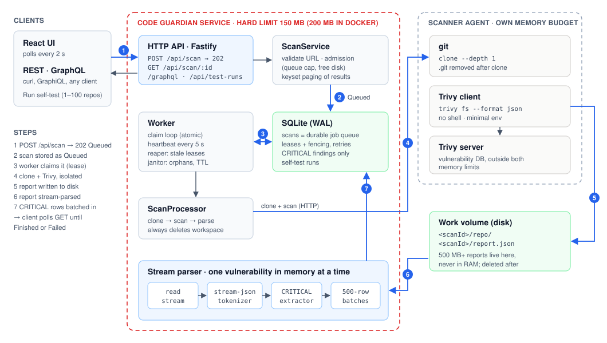

# Code Guardian

A Node.js + TypeScript service that wraps the [Trivy](https://trivy.dev) scanner. It clones a public GitHub repository, runs Trivy, **stream-parses** the JSON report (500 MB+), keeps only `CRITICAL` findings, deletes the clone and the report, and serves the results over REST and GraphQL. The service never exceeds its **150 MB** memory limit, page cache included.

[](https://github.com/armansw/oxsecurity-home-assignment/actions/workflows/ci.yml)

- **Live:** https://oxhometask.armstep.com. Scan any public repository, watch live memory against the limit, or press **Run self-test** to scan 1–100 large repositories.
- **Video:** [docs/demo.mp4](docs/demo.mp4) (34 s)



## Run it

```bash
./run.sh      # UI → http://localhost:5173 · API → http://localhost:3000
```

It needs only `bash`, `git`, `tar` and `curl`. If Node (≥ 22.12) or Trivy is missing, the script downloads it into `.cg-env/` and verifies its checksum, with no root and no global installs. On Windows, use WSL2 or Docker.

| Also | Command |
|---|---|
| Docker (`mem_limit: 200m`, Trivy sidecar, UI on :8080) | `docker compose up --build` |
| The brief's self-test (needs `git` + `trivy`) | `npm ci && npm run build && node --max-old-space-size=150 dist/index.js` |
| Tests · memory proof · environment check | `./run.sh test` · `./run.sh oom-check` · `./run.sh doctor` |

## API

| Endpoint | Purpose |
|---|---|
| `POST /api/scan` `{"repoUrl": "https://github.com/…"}` | Returns `202 {"scanId", "status": "Queued"}` at once; a background worker does the rest |
| `GET /api/scan/:scanId` | `Queued` · `Scanning` · `Finished` · `Failed`. Finished includes `criticalVulnerabilities`, streamed; `?limit=&cursor=` pages it |
| `POST /graphql` | `startScan(repoUrl)` and `scan(id) { id status criticalVulnerabilities { … } }`, the brief's schema |
| `POST /api/test-runs` `{"size": 1–100}` | Self-test: scans a sample of the [152-repository corpus](test/large/corpus.tsv) on this service |
| `GET /api/system/memory` | Live memory against the real (cgroup) limit |
| `/healthz` · `/readyz` · `/metrics` | Liveness, readiness (DB, scanner, disk), Prometheus |

Every error has one shape, `{"error": {"code", "message"}}`. A failed scan carries a stable code, such as `REPO_NOT_FOUND`, `SCANNER_FAILED`, `SCAN_TIMEOUT` or `DISK_FULL` ([full table](docs/ARCHITECTURE.md#error-taxonomy)).

## The brief, point by point

| Requirement | How it is met |
|---|---|
| `POST /api/scan` is non-blocking | One SQLite insert, then `202`. SQLite is also the durable job queue: atomic claims, leases, retries, crash recovery |
| Clone → Trivy → JSON file → stream-parse | `git clone --depth 1`, `trivy fs --format json -o report.json`, then `stream-json` with a token-level extractor |
| Report of 500 MB+ | One vulnerability in memory at a time, even when all findings sit in one `Results[0]` object |
| Store only `CRITICAL` | Filtered during the stream; written in 500-row transactions under backpressure |
| Delete repo and report | `finally` on every path; the clone is removed before parsing; a janitor handles hard kills |
| No `fs.readFile` / `JSON.parse` on results | Enforced by an ESLint rule and a CI grep |
| Runs in 256 MB, `--max-old-space-size=150` | Measured below; CI runs the whole service at 200 MB and at 150 MB |
| Trivy fails · disk full | Stable error codes, retry with backoff for transient faults, pre-flight disk check, `ENOSPC` detection; Java lookups go through a Maven Central mirror, so Maven Central's 429 IP blocks cannot fail a scan |
| Controller · Service · Worker | `interfaces/` → `application/` → `domain/` ← `infrastructure/`; `worker/` owns the claim loop |
| Type safety | Strict TypeScript, no `any`; zod at every boundary |
| Bonus A · React app polling every 2 s | `web/`: REST or GraphQL transport, live memory meter, self-test panel |
| Bonus B · GraphQL | Mercurius on the same service layer as REST |
| Bonus C · `docker-compose.yml`, `mem_limit: 200m` | Yes; git and Trivy run in a separate scanner container with their own budget |

## Memory, measured

| Run | Result |
|---|---|
| 600 MB report, all findings in one `Results[0]`, `node --max-old-space-size=150` | Peak heap **47 MB**; 14,041 of 14,041 CRITICAL stored in 25 s |
| Same report through the whole service in Docker, `mem_limit` 200m and 150m, no swap (CI) | Finished, `OOMKilled=false`, peak 97 / 94 MiB |
| [152-repository corpus](test/large/corpus.tsv), 9 ecosystems, burst-submitted, service at **150 MB** (CI) | **152/152**; all 793 CRITICAL of 15,631 findings matched an independent Trivy run; peak **96 MiB** including page cache; limit never reached; 0 OOM kills ([run](https://github.com/armansw/oxsecurity-home-assignment/actions/runs/42893164579)) |
| Live service, three in-app self-test runs (58 large repositories scanned) | Every scan within the limit: highest peak 77 MB of 150 MB, limit never reached, 0 OOM kills |

Six traps still run a streaming parser out of memory. Each is closed in this code and explained in [docs/MEMORY.md](docs/MEMORY.md):

1. One giant `Results[0]` object.
2. Collecting the findings in an array.
3. `JSON.stringify` of the response.
4. A tmpfs workspace.
5. git and Trivy charged to the same limit.
6. Dirty page cache.

## Tests

281 backend and 98 frontend tests, ~99 % line coverage. CI also runs:

- **Docker:** the service at 200 MB and at 150 MB, and API and worker as separate containers.
- **Install:** `./run.sh` from scratch on Linux and macOS.
- **Large repositories:** [`scripts/large_repos_e2e.py`](scripts/large_repos_e2e.py) scans real repositories through the running service, then runs Trivy independently on the same commit, parses that report with Python's `json` and requires an exact match. It also requires no OOM kill and an empty workspace afterwards. It covers 7 repositories (next.js, vscode, kubernetes, …) on every push to `main`, and the full corpus weekly in 8 parallel shards.

## More

- [docs/ARCHITECTURE.md](docs/ARCHITECTURE.md): layers, scan lifecycle, state machine, leases, error table, security model, decision records.
- [docs/MEMORY.md](docs/MEMORY.md): the memory design and its measurements.
- [deploy/](deploy/README.md): the live deployment (systemd + Caddy, `MemoryMax=150M`).
- [.env.example](.env.example): every setting. All are optional and validated at boot.
