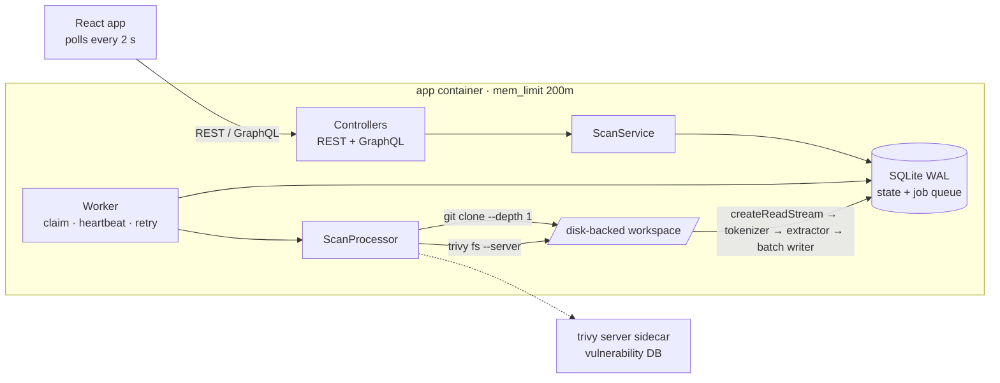

# Code Guardian

A backend service that wraps the [Trivy](https://trivy.dev) scanner. It clones a GitHub repository, runs Trivy, **stream-parses** the JSON report, which can be 500 MB or more, keeps only `CRITICAL` vulnerabilities, deletes the clone and the report, and exposes the result over REST and GraphQL. It is designed to run in a 200–256 MB container.

**Live demo:** https://oxhometask.armstep.com · **Walkthrough video:** [docs/demo.mp4](docs/demo.mp4) (34 s) (deployed with systemd under the same 200 MB limit: [deploy/](deploy/README.md))

[](https://github.com/armansw/oxsecurity-home-assignment/actions/workflows/ci.yml)

**Measured results:**

| Scenario | Peak heap | Peak RSS | Result |
|---|---|---|---|
| 600 MB report (280,839 findings, every one in one `Results[0]`) parsed under `--max-old-space-size=150` | **47 MB** | 130 MB | all 14,041 CRITICAL stored, 25 s |
| Real Trivy scan of OWASP NodeGoat | — | 112 MB | 93 findings scanned, 12 CRITICAL stored, 2.2 s |
| **Docker, `mem_limit: 200m`, no swap** (CI): the 600 MB report through the full service | — | container peak 97 MiB* | `Finished`, 14,041/14,041 CRITICAL, `OOMKilled=false`, workspace empty |
| **Docker, `mem_limit: 200m`** (CI): real Trivy scan of NodeGoat | — | — | `Finished`, 12 CRITICAL, `OOMKilled=false`, workspace empty |

The 25 s figure was measured with the process capped at 60 % of one CPU. \*`docker stats` usage, which excludes reclaimable page cache. See [Proving the memory claim](#proving-the-memory-claim), where every number comes from an actual run.



## Contents

- [Quick start](#quick-start)
- [Requirements traceability](#requirements-traceability)
- [Proving the memory claim](#proving-the-memory-claim)
- [API](#api)
- [Error handling](#error-handling)
- [Design decisions](#design-decisions)
- [Project layout, scripts, configuration](#project-layout)
- [Production next steps](#production-next-steps)
- Deep dives: [docs/ARCHITECTURE.md](docs/ARCHITECTURE.md) · [docs/MEMORY.md](docs/MEMORY.md)

## Quick start

### Docker (recommended)

```bash
docker compose up --build
# UI   → http://localhost:8080
# API  → http://localhost:3000
```

The first start downloads Trivy's vulnerability database (~1 min) into the `trivy` sidecar. The `app` container runs with `mem_limit: 200m` and no swap.

```bash
curl -s -X POST localhost:3000/api/scan -H 'content-type: application/json' \
     -d '{"repoUrl":"https://github.com/<you>/NodeGoat"}'
# → 202 {"scanId":"4d8cf725-…","status":"Queued"}

curl -s localhost:3000/api/scan/4d8cf725-…
# → {"status":"Scanning","phase":"scanning",…}  then  {"status":"Finished","criticalCount":12,"criticalVulnerabilities":[…]}
```

### Local (the brief's self-test command)

Requirements: Node ≥ 22.12, `git`, and `trivy` on `PATH`.

```bash
npm ci
npm run build
node --max-old-space-size=150 dist/index.js    # API + worker in one process (ROLE=all)
```

With no other infrastructure, that command gives a complete system: the database is an embedded SQLite file. The UI is in [`web/`](web/README.md) (`cd web && npm ci && npm run dev` → http://localhost:5173).

## Requirements traceability

| Brief | Where | How to verify |
|---|---|---|
| Never `fs.readFile` or `JSON.parse` the scan results | The whole backend: an ESLint rule bans both across `src/` ([eslint.config.mjs](eslint.config.mjs)), and a CI step greps for them | `npm run lint`, `grep -rnE 'JSON\.parse\(\|readFile' src/` returns nothing |
| Runs in a 256 MB pod; `node --max-old-space-size=150 dist/index.js` | `Dockerfile` CMD is exactly that command | `npm run oom:check`, CI `docker-e2e` |
| `POST /api/scan` does not block, returns `scanId` + `Queued` | [scan.controller.ts](src/interfaces/rest/scan.controller.ts): one INSERT, then `202` | `test/integration/api.test.ts` |
| Scan triggered in the background | [worker.ts](src/worker/worker.ts) claims from the durable queue | same |
| Clone to a temp folder | [git-repository-fetcher.ts](src/infrastructure/git/git-repository-fetcher.ts), [disk-workspace.ts](src/infrastructure/fs/disk-workspace.ts) | `test/unit/adapters.test.ts` |
| Run Trivy, output JSON to a file | [trivy-scanner.ts](src/infrastructure/scanner/trivy-scanner.ts) | same |
| Parse with Node streams (`stream-json`) | [stream-report-processor.ts](src/infrastructure/report/stream-report-processor.ts), [critical-vulnerability-extractor.ts](src/infrastructure/report/critical-vulnerability-extractor.ts) | `test/unit/critical-vulnerability-extractor.test.ts` |
| Store only `Severity: "CRITICAL"` | extractor + [trivy-schema.ts](src/infrastructure/report/trivy-schema.ts) | same |
| Delete the repo and the JSON afterwards | [scan.processor.ts](src/application/scan.processor.ts) `finally` (the clone is deleted even earlier, before parsing) | cleanup is asserted after success, failure, disk-full and shutdown in `test/unit/scan.processor.test.ts` |
| `GET /api/scan/:scanId` returns status + criticals | controller + [scan-json-stream.ts](src/interfaces/rest/scan-json-stream.ts) | `test/integration/api.test.ts` |
| Controller vs Service vs Worker | `interfaces/` → `application/` → `domain/` ← `infrastructure/`, with `worker/` separate | [docs/ARCHITECTURE.md](docs/ARCHITECTURE.md) |
| What if Trivy fails? What if the disk is full? | [Error handling](#error-handling) | `test/unit/scan.processor.test.ts`, `test/unit/adapters.test.ts` |
| TypeScript interfaces, no `any` | `strict` + `exactOptionalPropertyTypes` + `noUncheckedIndexedAccess`; `typescript-eslint` `strictTypeChecked`, `no-explicit-any: error` | `npm run lint && npm run typecheck` |
| Bonus A: React app, polls every 2 s | [web/](web/README.md) | `cd web && npm run test:coverage` |
| Bonus B: GraphQL API | [schema.ts](src/interfaces/graphql/schema.ts), [resolvers.ts](src/interfaces/graphql/resolvers.ts) | `test/integration/graphql.test.ts` |
| Bonus C: `docker-compose.yml` with `mem_limit: 200m` | [docker-compose.yml](docker-compose.yml) | CI `docker-e2e` asserts `OOMKilled=false` |
| README with run instructions | this file | — |

## Proving the memory claim

### 1. The OOM harness: 600 MB under a 150 MB heap

```bash
npm run oom:check   # = npm run build && node --max-old-space-size=150 dist/scripts/oom-check.js
```

The harness generates a Trivy-shaped report of 600 MB. Every finding sits inside **one** `Results[0]` object, the worst case explained under [the single-result trap](#the-six-memory-traps). It then runs the production `StreamReportProcessor` into SQLite and samples `process.memoryUsage()` every 100 ms. It exits non-zero unless every CRITICAL finding was stored **and** peak heap stayed under 100 MB. Actual output:

```
  600.0 MB, 280,839 vulnerabilities, 14,041 CRITICAL
Stream-parsing with --max-old-space-size=174 MB heap…
   10%  heapUsed=24 MB  rss=111 MB
   …
   90%  heapUsed=31 MB  rss=120 MB
report size                  600.0 MB
vulnerabilities scanned      280,839
CRITICAL expected / stored   14,041 / 14,041
duration                     25.0 s (24.0 MB/s)
heap limit                   174 MB
peak heapUsed                47 MB (budget 100 MB)
peak RSS                     130 MB
result                       PASS
```

("heap limit 174 MB" is V8's total: 150 MB old space plus the young generation.) Heap use is flat: it does not grow with the file size. Variants are `--critical-ratio 1`, where every finding is CRITICAL and the store path is stressed, `--layout many-results`, and `--size-mb N`. CI runs the 600 MB check and the all-critical run on every push.

### 2. In the 200 MB container, through the whole service

```bash
docker compose -f docker-compose.yml -f docker-compose.oom.yml up --build -d
./scripts/e2e-docker.sh --fixture
```

`SCANNER=fixture` swaps only the Trivy step for the 600 MB generator. Clone, queue, worker, stream parser, store and HTTP response are the production code. The script fails unless the scan is `Finished`, `docker inspect` reports `OOMKilled=false`, and the workspace is empty. `./scripts/e2e-docker.sh` without the flag does the same with a real Trivy scan of NodeGoat. **Both run in CI on every push** (`docker-e2e` job), and the CI log prints the container's peak memory.

### 3. Real NodeGoat scan, local, under the brief's command

```
POST /api/scan {"repoUrl":"https://github.com/OWASP/NodeGoat"}  → 202 Queued
GET  /api/scan/<id>  → Finished in 2.2 s · 93 scanned · 12 CRITICAL · worker peak RSS 112 MB
```

<details><summary>The 12 CRITICAL findings</summary>

| ID | Package | Installed | CVSS |
|---|---|---|---|
| CVE-2020-7610 | bson | 1.0.9 | 9.8 |
| CVE-2023-45311 | fsevents | 1.2.9 | 9.8 |
| CVE-2021-44906 | minimist | 0.0.8, 0.0.10, 1.2.0, 1.2.5 | 9.8 |
| CVE-2019-10746 | mixin-deep | 1.3.1 | 9.8 |
| CVE-2026-90711 | proxy-addr | 2.0.4 | 9.1 |
| CVE-2019-10747 | set-value | 0.4.3, 2.0.0 | 9.8 |
| CVE-2026-59873 | tar | 4.4.8 | 7.5 |
| CVE-2021-23358 | underscore | 1.9.1 | 9.8 |

</details>

## API

### REST

| Method | Path | Result |
|---|---|---|
| `POST` | `/api/scan` | body `{"repoUrl": "https://github.com/<owner>/<repo>"}` → **202** `{scanId, status: "Queued"}` + `Location` header |
| `GET` | `/api/scan/:scanId` | current status. When `Finished`, the **full** critical list, streamed |
| `GET` | `/api/scan/:scanId?limit=100&cursor=…` | one page + `nextCursor`, as the UI uses it |
| `GET` | `/healthz` | liveness + process memory |
| `GET` | `/readyz` | database, scanner, free disk, worker; 503 if any check fails |

The status response is a discriminated union on `status`:

```jsonc
{ "scanId": "…", "status": "Queued",   "repoUrl": "…", "attempt": 0, "createdAt": "…" }
{ "scanId": "…", "status": "Scanning", "phase": "parsing", "progressPct": 43, "startedAt": "…", … }
{ "scanId": "…", "status": "Failed",   "error": { "code": "SCANNER_FAILED", "message": "Trivy exited with code 1" }, … }
{ "scanId": "…", "status": "Finished", "criticalCount": 12,
  "stats": { "reportBytes": 574128, "vulnerabilitiesScanned": 93, "malformedSkipped": 0, "durationMs": 2217, "peakRssMb": 112 },
  "criticalVulnerabilities": [
    { "id": "CVE-2020-7610", "pkgName": "bson", "installedVersion": "1.0.9", "fixedVersion": "1.1.4",
      "severity": "CRITICAL", "title": "bson: Deserialization of Untrusted Data…", "description": "…",
      "primaryUrl": "https://avd.aquasec.com/nvd/cve-2020-7610", "target": "package-lock.json",
      "pkgType": "npm", "cvssScore": 9.8, "publishedDate": "…" } ] }
```

Other behaviour:

- **Deduplication.** Submitting a repository that is already `Queued` or `Scanning` returns that scan with `"deduplicated": true`.
- **Results only when complete.** Critical results appear only once a scan is `Finished`, never as a partial list.
- **Errors** use one envelope, `{"error":{"code","message"}}`, with these statuses:
  - `400`: invalid URL, body, id or cursor
  - `404`: unknown scan
  - `413`: body too large
  - `429`: queue full, with `Retry-After`; or rate limited, at 30 POSTs per minute per IP
  - `503`: not enough disk to accept work
  - `500`: unexpected; the response is generic and the detail goes to logs only

### GraphQL (Bonus B): `POST /graphql`

GraphiQL is served at `/graphiql` outside production. The schema is a superset of the brief's example. `status` is an enum, and the vulnerability list is paginated, with `first` clamped to 1–1000, so no single query can pull an unbounded list into memory.

```graphql
mutation { startScan(repoUrl: "https://github.com/<you>/NodeGoat") { id status } }

query {
  scan(id: "…") {
    id status phase progressPct criticalCount
    stats { reportBytes vulnerabilitiesScanned durationMs peakRssMb }
    error { code message }
    criticalVulnerabilities(first: 100, after: null) { id cursor pkgName installedVersion fixedVersion cvssScore }
  }
}
```

Errors carry `extensions.code`, using the same codes as REST. Query depth is limited to 6.

## Error handling

Every failure ends in a terminal state with a stable `error.code`, or in a retry. The workspace is always deleted. Raw failures (exit codes, errno, stderr) are classified once, in the adapter that understands them, so the API never leaks host paths or stack traces.

| Failure | Detected by | Code | Retried |
|---|---|---|---|
| Repo missing or private | git exit 128, stderr `not found` / `could not read Username` | `REPO_NOT_FOUND` | no |
| Network error while cloning | other git failure | `CLONE_FAILED` | yes |
| Clone or scan too slow | our timeout (process group killed) | `CLONE_TIMEOUT` / `SCAN_TIMEOUT` | yes |
| Trivy not installed | spawn `ENOENT` | `SCANNER_UNAVAILABLE` | no |
| Trivy exits non-zero (DB download, server down, …) | exit code | `SCANNER_FAILED` | yes |
| Trivy killed by the kernel OOM killer | `SIGKILL` we did not send | `SCANNER_KILLED` | yes |
| Report missing, empty, truncated, not JSON, or a value over 1 MiB | `stat`, tokenizer, extractor end-of-document check | `REPORT_INVALID` | no |
| Not enough free disk before starting | `statfs` pre-flight | `INSUFFICIENT_DISK` | yes |
| Disk fills up mid-job | `ENOSPC` / `EDQUOT` / `SQLITE_FULL` / "No space left on device" | `DISK_FULL` | yes |
| Worker crashed or was OOM-killed mid-scan | stale heartbeat (reaper) | re-queued; `WORKER_CRASHED` after the last attempt | yes |
| Anything else | — | `INTERNAL` (generic message) | no |

Retries use exponential backoff (5 s, 20 s, 80 s, ±20 % jitter) with at most 3 attempts.

**If Trivy fails:** the last 8 KiB of stderr is kept, never the full output, and logged with the `scanId`. The failure is classified and retried if transient. The scan ends `Failed` with a stable code and a clean message, and the workspace is deleted in `finally`.

**If the disk is full:** four layers handle it.

1. **Pre-flight check.** A `statfs` check before cloning fails fast. `POST /api/scan` also refuses work with `503` while the disk is low.
2. **Detection mid-job.** Running out of space in git, Trivy, the file stream or SQLite is recognised and mapped to `DISK_FULL`, which is retryable.
3. **Space is freed early.** The clone is deleted *before* parsing begins, and `finally` always removes the workspace.
4. **Recovery after a hard kill.** A janitor removes workspaces orphaned by a hard kill, since `SIGKILL` skips `finally`.

A report truncated by a full disk can **never** be reported as `Finished`. The extractor fails any document that does not close.

## Design decisions

The full ADRs are in [docs/ARCHITECTURE.md](docs/ARCHITECTURE.md); the memory reasoning is in [docs/MEMORY.md](docs/MEMORY.md).

### The six memory traps

The obvious solution is `stream-json` → `StreamArray` over `Results` → push criticals into an array → `res.json(...)`. It passes on NodeGoat and fails the actual brief. This design closes each trap:

1. **The single-result trap.** Trivy groups findings per target, so a 500 MB report is typically **one** `Results[0]`. Streaming at the `Results[]` level assembles that whole object in memory. Here a token-level state machine materialises one *vulnerability* at a time.
2. **The accumulate-in-an-array trap.** If 30 % of 500 MB is CRITICAL, the result array is itself the OOM. Instead, findings are flushed to SQLite in 500-row transactions under stream backpressure.
3. **The egress trap.** A single `JSON.stringify` of the result list recreates the problem on the way out. The status response is **streamed** from keyset-paged reads, and a slow client holds one page.
4. **The tmpfs trap.** A workspace on tmpfs, or a K8s `emptyDir` with `medium: Memory`, charges the 500 MB file to the container's memory. The work volume is explicitly disk-backed.
5. **The child-process trap.** `mem_limit` covers Node *and* git *and* Trivy. Measured: Trivy's own anonymous memory is ~30 MB, but its vulnerability DB is 1.7 GB on disk and is memory-mapped. In Docker it lives in a Trivy *server* sidecar, so the DB, its download and its page cache stay outside the app's 200 MB. Trivy also runs with `GOMEMLIMIT=64MiB` and `--parallel 1`.
6. **The dirty-page-cache trap**, which CI caught. Page cache counts against the container's limit, and dirty pages can't be reclaimed until they are flushed. Writing the 600 MB report faster than the CI runner's disk could flush got the container OOM-killed while its heap was **46 MB**. Large writes now `fdatasync` every 8 MB ([details](docs/MEMORY.md#6-the-dirty-page-cache-trap-found-by-ci)).

### Other decisions

- **SQLite is both the state store and the job queue** (no Redis). This keeps the brief's one-line self-test working with zero infrastructure. It gives durability across restarts, atomic claim, leases with fencing tokens, retries and crash recovery, without the "row saved but enqueue failed" dual write. Everything sits behind the `ScanStore` port, so swapping in Postgres with `FOR UPDATE SKIP LOCKED` or BullMQ is an adapter change.
- **No `--severity CRITICAL` flag for Trivy.** In production you would push the filter down to the scanner. The brief explicitly tests filtering a huge report in *our* pipeline.
- **The stream-json tokenizer is fused with the extractor** in one `stream-chain` stage. Tens of millions of tokens pass by function call, and only CRITICAL findings cross a stream boundary. This took throughput from 8 to 24 MB/s.
- **Bounded hostile input.** Any single JSON string or number over 1 MiB, or nesting deeper than 64, fails the report. Memory is therefore bounded even for a malicious report, not just Trivy's.
- **The repo URL is attack surface.**
  - Only `https://github.com/<owner>/<repo>` is accepted. That rules out other hosts (SSRF), `file://`, `ssh://`, `ext::`, option injection, credentials and traversal.
  - git runs with `--` and no shell, with `protocol.file.allow=never` and `GIT_TERMINAL_PROMPT=0`.
  - Child processes get a minimal environment, so service secrets never reach git or Trivy.

## Project layout

```
src/
  domain/          types, error taxonomy, ports (no I/O, no frameworks)
  application/     ScanService (use cases), ScanProcessor (job orchestration)
  worker/          claim loop, reaper, janitor, graceful shutdown
  infrastructure/  SQLite store · git · Trivy/fixture scanners · report stream pipeline · workspace · process runner
  interfaces/      REST controller · GraphQL · error mapping · health
  scripts/         oom-check, generate-fixture
  index.ts         composition root (the only place that knows concrete classes)
test/              unit/ + integration/ (198 tests)
web/               React client (Bonus A)
docs/              ARCHITECTURE.md, MEMORY.md
```

| Script | |
|---|---|
| `npm run build` / `start` / `start:constrained` | compile / run / run with `--max-old-space-size=150` |
| `npm run dev` | watch mode (tsx) |
| `npm run check` | lint + typecheck + tests with coverage thresholds |
| `npm run oom:check` | 600 MB memory proof |
| `npm run fixture:generate -- --size-mb 600 --out r.json` | write a synthetic report |

**Tests:** 198 backend tests and 75 frontend tests. Backend coverage is 99.7 % lines and 93.8 % branches, enforced at 95 % / 90 % in CI. The tests run the tokenizer at every chunk size down to 1 character, including multibyte UTF-8. They also drive git and Trivy through fake binaries and run the HTTP stack end-to-end with a real worker.

**Configuration:** all variables are optional and validated at boot. See [.env.example](.env.example). The important ones:

| Variable | Default | |
|---|---|---|
| `ROLE` | `all` | `all` \| `api` \| `worker` |
| `DATABASE_PATH` | `./data/code-guardian.db` | |
| `WORK_DIR` | `$TMPDIR/code-guardian` | must be disk-backed |
| `TRIVY_SERVER_URL` / `TRIVY_TOKEN` | unset | client/server mode |
| `SCANNER` | `trivy` | `fixture` for the OOM proof |
| `MAX_ATTEMPTS` | `3` | |
| `WORKER_CONCURRENCY` | `1` | a memory decision, not a throughput knob |
| `MIN_FREE_DISK_MB` | `1024` | pre-flight floor |
| `ALLOWED_GIT_HOSTS` | `github.com` | |

## Production next steps

Deliberately out of scope for a home assignment, but this is the path:

- **Scale-out queue:** Postgres with `SKIP LOCKED` (same lease semantics), or BullMQ, behind the existing `ScanStore` port. Run workers as their own Deployment (see `docker-compose.split.yml`).
- **Sandboxing:** cloning untrusted repositories is a hostile-input problem. Run workers in gVisor or Firecracker with egress limited to GitHub and the Trivy server.
- **Authentication and quotas:** tenant scoping on scans, plus per-tenant rate limits.
- **Observability:** Prometheus metrics (queue depth, scan duration, peak RSS per scan, failure codes) and OpenTelemetry traces across API → worker → child processes.
- **Push instead of poll:** SSE or webhooks on completion. Polling is kept here because the brief asks for it.
- **Report retention:** if raw reports must be kept, stream them to object storage instead of deleting them.
