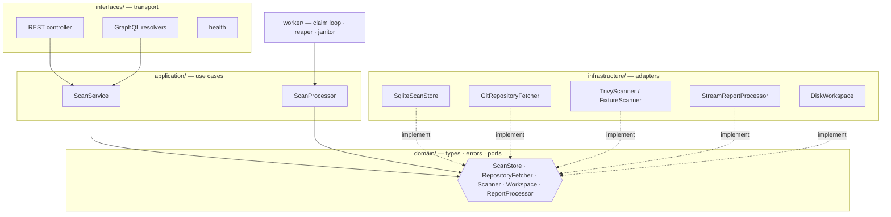
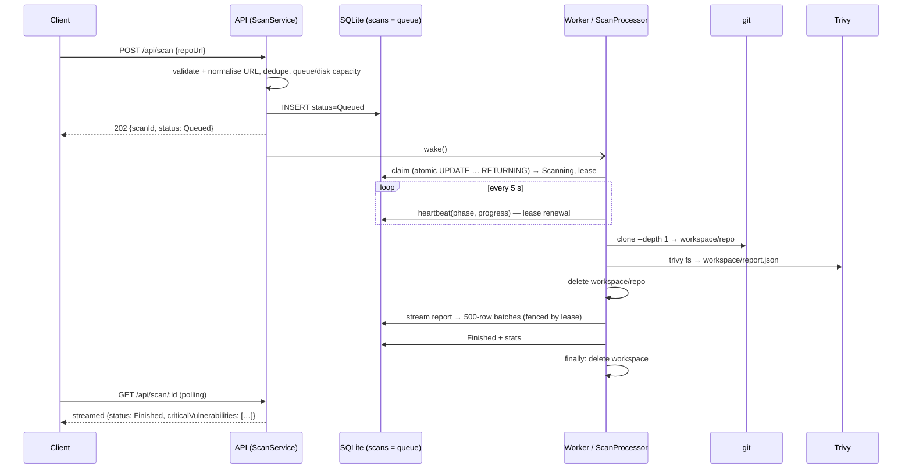
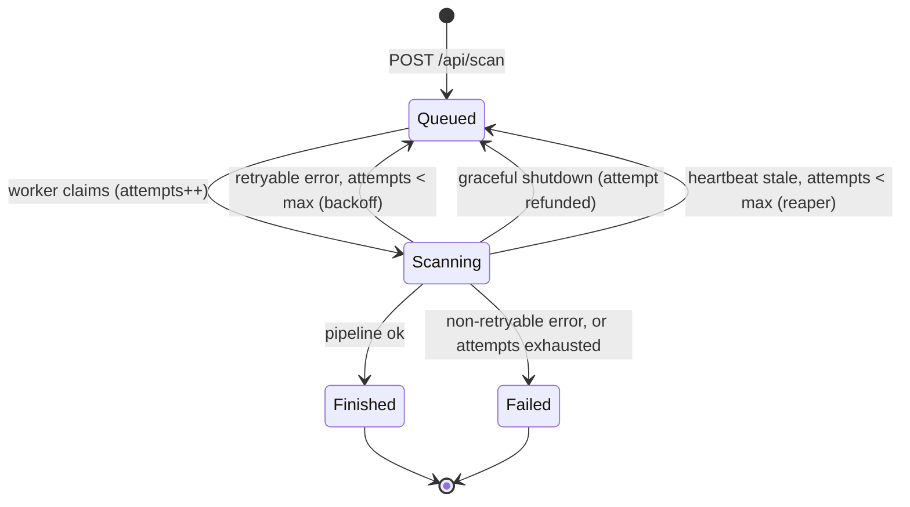

# Architecture

## Layers

Dependencies point inward. `domain/` imports nothing from the other layers. Controllers validate input, call `ScanService` and map the result to a DTO, with no logic of their own. REST and GraphQL share the same service, so they behave identically. `src/index.ts` is the only composition root, using plain constructor injection with no container.

**Controller vs Service vs Worker.** The controller answers HTTP. `ScanService` decides what a request means: validation, deduplication, admission control and pagination. The worker decides *when* work runs. `ScanProcessor` decides *how* one scan runs. The same image runs as `ROLE=all|api|worker`, so the module boundary can also become a process boundary (`docker-compose.split.yml`).

## Lifecycle of one scan

## State machine

The public status is exactly the brief's four values. `phase` (`cloning | scanning | parsing`) and `progressPct` are extra detail, exposed only while a scan is `Scanning`.

## Leases, fencing and recovery

- **Claim.** A single `UPDATE … WHERE id = (SELECT … ORDER BY created_at LIMIT 1) RETURNING *`. SQLite serialises writers, so two workers can never claim the same scan.
- **Lease.** `locked_by` + `heartbeat_at`. The processor renews it every 5 s and publishes phase and progress at the same time.
- **Fencing.** Every worker write carries `AND locked_by = @workerId AND status = 'Scanning'`. Vulnerability batches check the lease *inside* the insert transaction. A worker whose lease was reclaimed, for example after a long GC pause, gets `false` or `LeaseLostError`, aborts its job, and can never write into a scan another worker now owns.
- **Reaper.** Runs every `STALE_AFTER_MS / 2`. A scan whose heartbeat is older than 60 s is re-queued, or failed with `WORKER_CRASHED` once `attempts ≥ MAX_ATTEMPTS`. That cap is the poison-pill guard: a repository that OOM-kills its worker cannot loop forever.
- **Idempotent retries.** Each attempt starts by deleting that scan's rows, and results become visible only through the single statement that marks the scan `Finished`. Clients never see a partial list, and a retry never duplicates rows.
- **Janitor.** Runs at boot and then hourly. It deletes `scan-*` workspaces whose scan is not `Scanning` (a `SIGKILL` skips `finally`), and purges terminal scans older than `SCAN_TTL_HOURS`.
- **Graceful shutdown** (SIGTERM/SIGINT):
  1. Stop accepting HTTP requests.
  2. Abort the in-flight job. This kills the child process group and tears down the stream pipeline.
  3. Re-queue the scan with its attempt refunded.
  4. Delete the workspace and close the database.

  If this takes longer than `SHUTDOWN_GRACE_MS`, the process exits hard. Compose sets `stop_grace_period: 15s` and `init: true`.

## Error taxonomy

`domain/errors.ts` defines `ScanError(code, message, retryable)`. Each adapter classifies its own raw failures, because only it knows what they mean:

- git exit 128 with "not found" in stderr → `REPO_NOT_FOUND`
- Trivy `SIGKILL` we did not send → `SCANNER_KILLED`
- tokenizer exception → `REPORT_INVALID`

`classifyFailure` handles what can surface from anywhere: disk exhaustion (errno, SQLite, message, nested causes), aborts, lease loss, and `INTERNAL` for everything else. Messages stored on a scan are written for clients; details stay in the logs.

| Failure | Detected by | Code | Retried |
|---|---|---|---|
| Repo missing or private | git exit 128, stderr `not found` / `could not read Username` | `REPO_NOT_FOUND` | no |
| Network error while cloning | other git failure | `CLONE_FAILED` | yes |
| Clone or scan too slow | our timeout (process group killed) | `CLONE_TIMEOUT` / `SCAN_TIMEOUT` | yes |
| Trivy not installed | spawn `ENOENT` | `SCANNER_UNAVAILABLE` | no |
| Trivy exits non-zero (DB download, server down, …) | exit code | `SCANNER_FAILED` | yes |
| Trivy killed by the kernel OOM killer | `SIGKILL` we did not send | `SCANNER_KILLED` | yes |
| Report missing, empty, truncated, not JSON, or a value over 1 MiB | `stat`, tokenizer, extractor end-of-document check | `REPORT_INVALID` | no |
| Not enough free disk before starting | `statfs` pre-flight | `INSUFFICIENT_DISK` | yes |
| Disk fills up mid-job | `ENOSPC` / `EDQUOT` / `SQLITE_FULL` / "No space left on device" | `DISK_FULL` | yes |
| Worker crashed or was OOM-killed mid-scan | stale heartbeat (reaper) | re-queued; `WORKER_CRASHED` after the last attempt | yes |
| Anything else | — | `INTERNAL` (generic message) | no |

Retries use exponential backoff (5 s, 20 s, 80 s, ±20 % jitter) with at most 3 attempts.

## External processes

`runCommand` is the only place that spawns. It uses:

- an argument vector, with no shell and no string interpolation;
- `stdout` discarded and `stderr` kept as a bounded 8 KiB tail;
- `detached: true`, so timeout and abort kill the whole process group (git forks `git-remote-https`);
- SIGTERM, then SIGKILL after 5 s;
- an explicit, minimal environment, so the service's own variables (tokens, secrets) never reach git or Trivy.

## Security model

| Threat | Mitigation |
|---|---|
| SSRF or local-file reads through the repo URL | Exact allow-list: `https`, host in `ALLOWED_GIT_HOSTS`, no port, credentials, query or fragment, `/<owner>/<repo>` only; `protocol.file.allow=never` |
| Argument injection into git | URL validated, then passed after `--`; no shell |
| Credential prompts hanging a worker | `GIT_TERMINAL_PROMPT=0`, empty credential helper, global and system git config disabled |
| Secret leakage to children | minimal child environment |
| Hostile report (huge strings, deep nesting) | tokenizer `maxPackedLength` 1 MiB, `maxDepth` 64; descriptions truncated to 4 KiB |
| Leaking internals in errors | client-safe messages; 500s are generic |
| Abuse | rate limit on `POST /api/scan`, queue cap → 429, body limit 4 KiB, GraphQL depth limit, page size ≤ 1000 |
| Container breakout surface | non-root user, `cap_drop: ALL`, `no-new-privileges`, `pids_limit` |

Scanning untrusted repositories is still hostile-input processing. In production, workers belong in a sandbox (gVisor or Firecracker) with egress restricted to GitHub and the Trivy server.

## Decision records

**ADR-1: SQLite is both the state store and the job queue.**
*Context:* the reviewers' self-test is one `node` command, and the service must survive restarts. *Decision:* the `scans` table, with WAL, is the queue: `status='Queued'` rows plus lease columns. *Consequences:*
- zero infrastructure;
- durability, atomic claim and crash recovery;
- no dual-write window between the database and a broker.

The limit is that workers must share one host or volume. Postgres with `FOR UPDATE SKIP LOCKED` is a drop-in adapter behind `ScanStore`.

**ADR-2: one image, three roles.** `ROLE=all` (the default) runs the API and worker in one process, so the self-test works. `api` and `worker` split them, so a heavy scan can never starve or OOM the API.

**ADR-3: Trivy in client/server mode in Docker.** Measured on NodeGoat:

| Mode | Anonymous memory | File-backed memory |
|---|---|---|
| Standalone | 32 MB | 88 MB |
| Client | 27 MB | 87 MB |

The file-backed memory is the 176 MB binary plus the mmapped DB. The real difference is that standalone mode downloads, decompresses and mmaps a 1.7 GB database *inside* the app container. The sidecar keeps that outside the 200 MB limit. Without `TRIVY_SERVER_URL`, standalone mode is used, which suits local development.

**ADR-4: no `--severity CRITICAL` pushed down to Trivy.** The brief tests filtering a huge report in our own stream. In production you would push the filter down and keep this pipeline as defence in depth.

**ADR-5: `git clone` + `trivy fs` rather than `trivy repo`.** The brief requires cloning to a temp folder, and the split makes fetch and scan independently timeout-able, classifiable and retryable.

**ADR-6: results are typed columns, not JSON blobs.** Reading results back needs no `JSON.parse` anywhere, and keyset pagination by `row_id` is index-only.

**ADR-7: worker concurrency 1 by default.** Every job owns a git process, a Trivy process and a parse. In a 200 MB container, concurrency is a memory budget, not a throughput setting. Scale out with more worker containers instead.
